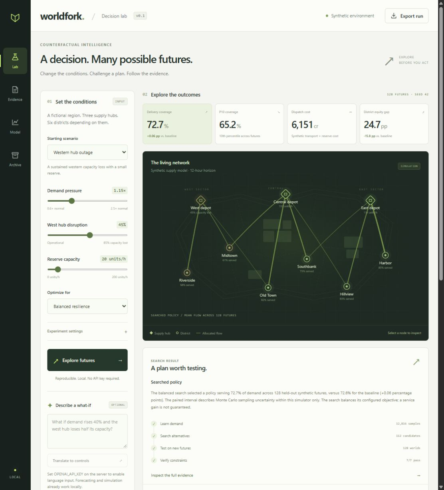

# WorldFork

**Rehearse a crisis before it happens.** WorldFork is a local decision laboratory for a synthetic supply network. Change demand, disable part of a distribution hub, add reserve capacity, and compare allocation policies across simulated futures.

It combines a learned demand forecast, constrained policy search, and Monte Carlo evaluation. The result is an inspectable experiment: a recommended policy, alternatives, district outcomes, uncertainty ranges, sensitivity runs, and resource-conservation checks.

WorldFork is a research prototype. Its network and demand data are synthetic. Its results describe the simulator, not a real city, emergency response system, or causal effect in the world.



## Run locally

Requires Python 3.11 or newer.

Clone this repository and run the commands from its root directory. This project runs from a source checkout.

```powershell
py -m venv .venv
.\.venv\Scripts\Activate.ps1
python -m pip install -r requirements.txt
python -m worldfork.server
```

Open [http://127.0.0.1:8787](http://127.0.0.1:8787). No cloud account or API key is required for simulation. If the port is occupied, choose another with `python -m worldfork.server --port 8788`.

On Windows, `./Start-WorldFork.ps1` also starts the app using an existing virtual environment or an available compatible runtime. Keep the terminal open while using the workbench.

1. Choose a scenario or set demand, disruption, reserves, and the objective.
2. Run the experiment and compare the baseline with the searched policy.
3. Inspect district service, coverage bands, sensitivity, and evidence.
4. Export the complete experiment as JSON for inspection or comparison.

## What is applied AI here?

- **Prediction:** a ridge-regression model learns demand from generated historical observations and is measured against a baseline on held-out data.
- **Decision search:** bounded search compares allocation parameters under hub and route constraints.
- **Evaluation:** policies face the same held-out simulated futures, separate from the futures used during search.
- **Optional language interface:** a configured OpenAI model translates a plain-language scenario into validated numeric inputs. Simulation and ranking remain deterministic for a given scenario and seed.

The computational stages are ordinary algorithms. They are not autonomous LLM agents, and the optimizer does not prove a globally optimal solution.

## Optional language interface

Configure the server process with `OPENAI_API_KEY` and, optionally, `OPENAI_MODEL` (default `gpt-4.1-mini`), then restart it. The interface reports whether the provider is configured. `.env` files are not automatically loaded; the variable names are shown in `.env.example`. Keep credentials outside source control and browser code.

Using this feature sends the scenario prompt to OpenAI and may incur provider charges. Do not include sensitive or personal data. The model has no tools, file access, or authority to execute a plan. Its output must pass the same scenario validation as manual inputs. Without a key, the numerical workbench remains available.

## Project layout

```text
worldfork/       Forecast, simulator, policy search, and HTTP service
web/             Browser workbench
tests/           Engine and service checks
docs/            Method, API, security, and validation details
.worldfork/      Local run database created at runtime; excluded from Git
```

See [architecture](docs/architecture.md), [model card](docs/model-card.md), [validation](docs/validation.md), and [security](SECURITY.md).

## License

[MIT](LICENSE).

## Verify

```powershell
python -m unittest discover -s tests -v
```

The suite exercises the numerical engine, local HTTP boundary, persistence, and a mocked language provider. It does not require a provider key or establish that live OpenAI access works. Completed verification and its limits are recorded in [validation](docs/validation.md).

## Boundaries

- Designed for one trusted operator on a local machine; it is not an authenticated, multi-user service.
- No live demand feeds, real logistics integration, operational dispatch, or production deployment is included.
- Simulation ranges quantify variation under the chosen synthetic model. They are not calibrated real-world confidence intervals.
- Objective weights encode tradeoffs. A higher score is not a moral, economic, or public-policy endorsement.
- A fixed seed supports reproducibility within the documented runtime; model and dependency changes can change outputs.
