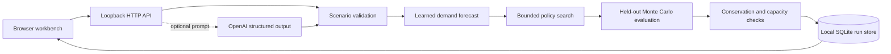

# Architecture

WorldFork runs as a local Python HTTP service with a static browser workbench. NumPy supplies the numerical runtime. SQLite stores completed experiment records.

## Experiment flow

1. Validate a scenario with an explicit objective, bounded resource inputs, a seed, and a simulation count. Reject unknown fields and unsupported values.
2. Forecast demand for a fixed 12-hour horizon from a model fitted to synthetic historical observations.
3. Compare candidate allocation policies on the search simulation stream.
4. Evaluate the chosen policy and alternatives on a separate stream. Use common futures across policies so the comparison is not driven by different random draws.
5. Re-evaluate the selected policy under defined perturbations for sensitivity analysis.
6. Return inspectable metrics, method metadata, evidence stages, validation checks, and the simulator's limitations.
7. Persist the completed result and allow retrieval or JSON export.

Search and evaluation are separated to reduce overfitting to the futures used to select a policy. Both still come from the same synthetic generator, so this does not establish transfer to real operations.

## Service boundary

The service owns validation, simulation, provider access, and persistence. The browser supplies inputs and presents results. It never receives the provider credential. The optional language model proposes scenario data only; it cannot run shell commands, choose an outbound URL, read local files, or dispatch resources.

The run database is a bounded local history, not a multi-tenant data service. The API token protects state-changing browser requests against cross-origin submission. It is not a user identity or an authorization boundary against other local processes.

## Resource limits

| Boundary | Limit |
| --- | --- |
| HTTP request body | 16 KiB |
| Active HTTP connections | 8 |
| Concurrent experiment or provider request | 1 |
| Requests | 120 per minute, including at most 12 writes |
| Scenario prompt | 2,000 characters |
| Provider response | 64 KiB |
| Stored experiment | 1 MiB |
| Retained history | At most 100 runs and 16 MiB of result payloads; oldest runs are removed |
| SQLite database pages | 32 MiB maximum; journal and filesystem overhead are separate |

The HTTP socket timeout is 8 seconds and the provider socket timeout is 20 seconds. These are I/O inactivity limits, not guaranteed end-to-end execution deadlines. Rate limits are shared by the single local operator and reset when the server restarts.

The default run store is `.worldfork/runs.sqlite3` in the source directory. `--data-dir` selects another local directory. Static files are served from an explicit allowlist under `web/`.

The HTTP route and payload definitions are documented in [contract.md](contract.md). Numerical assumptions and metric definitions are documented in the [model card](model-card.md).

The optional provider uses the Responses API with a strict JSON schema, `store: false`, and application-side revalidation. Its request format follows the [official Structured Outputs documentation](https://developers.openai.com/api/docs/guides/structured-outputs?api-mode=responses). Live account/model availability is not assumed from stubbed tests.
